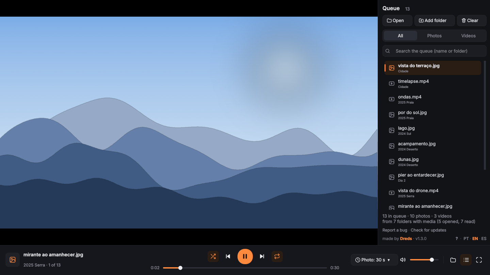
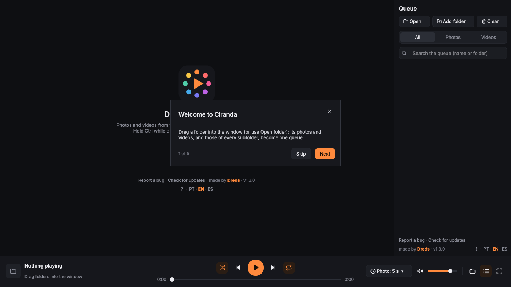
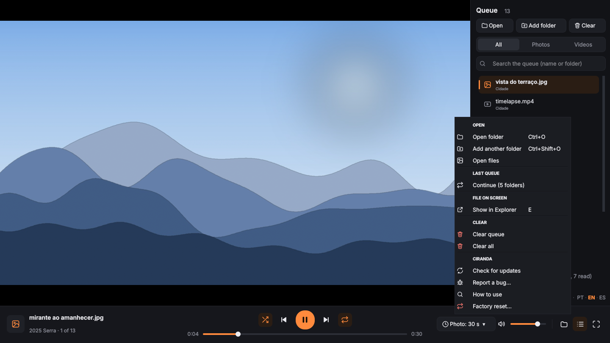

<div align="center">


# Ciranda

**Drop a folder, watch everything in it.**
A Windows player that takes a folder and **every subfolder inside it** and plays all the photos and videos as one queue, in order or shuffled, on repeat.




</div>

---

## Why

VLC can sort of do this (a hidden *subdirectory behavior* option, photos with a fixed duration, reports of it only expanding the first level). I wanted one thing done well: point at a folder of trips, birthdays and phone dumps and have *all* of it play, mixed, with no limit on how many folders or how deep they go.

## What it does

- **One queue for the whole tree.** Open one or many folders (button, `Ctrl+O`, drag and drop, *Open with*, or the right-click menu on a folder) and every subfolder at any depth goes in. Hold `Ctrl` while dropping to add to the current queue without stopping what's playing.
- **No limits.** No cap on files, folders or depth: the scan uses a stack, not recursion. Hidden folders and folders with custom icons are included; only the recycle bin and system folders are skipped by name.
- **In order:** each folder's files first, then its subfolders, in natural order (`photo2` before `photo10`).
- **Shuffle like a deck of cards (`S`):** every file plays once per round, then it reshuffles, and the last one of a round never opens the next.
- **Repeat (`R`):** off → whole queue → this one.
- **Photos, videos or both** (`1` / `2` / `3`), and a photo timer (5 s by default, `+` / `−`) that pauses with the player.
- **Plays what mpv plays:** MP4, MKV, MOV, AVI, WMV, WebM, MPEG-TS, 3GP and many more; JPG, PNG, WebP, GIF (animated), BMP, TIFF, AVIF, JXL. iPhone **HEIC/HEIF** photos are converted once to a cache, ahead of time. Phone photos taken sideways are rotated from EXIF.
- **Broken files don't stop the show:** a file that won't open is marked in red in the queue and skipped.
- **Queue panel (`L`)** with search (`Ctrl+F`), double-click to play, and right-click to show in Explorer, copy the path or remove. The footer counts photos, videos and folders.
- **Full screen** (`F`, `Enter`, `F11` or double-click), with controls that hide after 2.5 s.
- Remembers volume, shuffle, repeat, filter, photo time, window size and the last queue (a **Continue** button on the start screen).
- **Can be your default photo and video app.** The installer registers Ciranda for photos and videos, so it shows up in *Open with* and in **Settings → Apps → Default apps**. Windows doesn't let any app make itself the default, so you pick it once there (the installer and the folder menu have a shortcut to that screen). Double-clicking a file plays just that file.
- **One window.** Opening another file or folder while Ciranda is open sends it to the open window instead of starting a second one; several files opened together are queued together.
- **Updates itself.** When a new version is out on GitHub, a small card in the middle of the window says so when Ciranda opens, with what changed (a slim bar at the top if it shows up while you're watching; it's checked every 6 hours, or by hand with *Check for updates* in the footer). The card's X hides that version until a newer one comes out. *Update* downloads the setup from the release, checks it against the SHA-256 GitHub publishes for that file, installs it silently and reopens Ciranda on the new version. Your settings stay. Nothing about you is sent: it's a public read of the latest release.
- **Report a bug from inside the app** (*Report a bug* at the bottom of the queue panel and of the start screen, or in the folder menu): you write what happened, see a diagnostic (versions, settings, end of the log) with every folder name, file name, user name and PC name removed (only the extension stays), and it opens a new GitHub issue already filled in. Nothing is sent until you click there. No GitHub account? *Copy report* copies it.
- **Portuguese, English and Spanish.** The first time, Ciranda follows the Windows display language (anything else falls back to English); the **PT · EN · ES** switch in the footer changes it on the spot and is remembered. The installer follows Windows too.
- **First-run tutorial and "What's new".** A short tutorial shows up the first time (the **?** in the footer brings it back), and after each update a "What's new in vX.Y.Z" card lists the changes once. Neither one stops playback; X or Esc closes them.
- **Folder menu** (folder icon on the bar): open a folder, add another one, open loose files, continue the last queue, show the current file in Explorer, clear the queue or clear everything (queue + the *Continue* list), check for updates, report a bug, the tutorial and factory reset.
- **Factory reset** inside the app, plus `RESTAURAR.bat` in the portable zip for when it won't even open. Neither touches your files.

<p align="center">


</p>

### Keys

| Key | Action |
|---|---|
| `Space` / `K` | play / pause |
| `N` / `PgDn`, `P` / `PgUp` | next, previous (media keys work too) |
| `←` / `→` | 5 s in a video, previous / next photo |
| `Shift` + `←` / `→` | 30 s |
| `↑` / `↓`, `M` | volume, mute |
| `F`, `Enter`, `F11` | full screen (`Esc` leaves, or closes a card) |
| `S`, `R` | shuffle, repeat |
| `1` / `2` / `3` | everything / photos only / videos only |
| `+` / `−` | photo time up / down (1 s) |
| `L`, `Ctrl+F` | queue panel, search |
| `E` | show the file in Explorer |
| `Ctrl+O`, `Ctrl+Shift+O` | open folder, add folder |

## Install

1. Download **Ciranda-Setup-X.Y.Z.exe** from the [latest release](https://github.com/DredsGG/ciranda/releases/latest) and run it.
2. No admin rights needed: it installs for your user (`%LOCALAPPDATA%\Programs\Ciranda`), adds **Ciranda** to the Start menu and, if you tick them, a desktop shortcut, a **Play in Ciranda** entry when you right-click a folder and the photo/video registration (*Open with* and *Default apps*). To make it the default, tick the last box at the end of the setup, or go to **Settings → Apps → Default apps → Ciranda**. Everything is inside the app: no Python, no scripts.
3. The installer isn't code-signed, so the first time Windows may show *"Windows protected your PC"*: click **More info → Run anyway**.
4. Updating: Ciranda tells you when there's a new version and updates itself (or run the newer setup over it). Uninstall from **Settings → Apps**; settings stay in `%APPDATA%\Ciranda`.

**Portable alternative:** `ciranda-vX.Y.Z-portatil.zip` from the same release. Unzip, double-click `Ciranda.exe`; the first time it installs Python 3.12 with `winget` and the dependencies (1 to 3 minutes). The portable copy doesn't update itself: *Update* opens the release page.

## Known limitations

- Windows 10/11, 64-bit only.
- The installer isn't code-signed, so SmartScreen warns on the first run (see above).
- Windows doesn't let apps make themselves the default: you pick Ciranda once in *Default apps* (or *Open with → Always*).
- No subtitles menu, playlists or editing: it's a "play this whole folder tree" player.
- The first time an iPhone HEIC photo shows up it takes a moment to convert; after that it comes from the cache (`%APPDATA%\Ciranda\cache-heic`, trimmed to 1 GB when Ciranda closes).
- The portable zip needs internet and `winget` on the first run.

## How it's built

```
instalador/            ciranda.spec (PyInstaller, one folder) + ciranda.iss (Inno Setup) + gerar_versao.py
Ciranda.exe            in the portable zip: small C launcher (lancador/) that runs pythonw app.py
app.py                 entry point; takes folders/files as arguments; --autoteste=<file.json> self-test
ciranda/biblioteca.py  scan: os.scandir with a stack, natural sort, no duplicates, junction-loop guard
ciranda/fila.py        queue: order, deck shuffle, repeat, filter, add/remove, skip broken (no UI, testable)
ciranda/janela.py      PySide6 interface with libmpv embedded in a native area
ciranda/fotos.py       HEIC → JPEG cache
ciranda/config.py      %APPDATA%\Ciranda\config.json (settings, language, what's-new and tutorial seen)
ciranda/autoteste.py   the self-test: sample photos, real clicks on the menus, language switch, tutorial card
ciranda/atualizacao.py update: latest release from the GitHub API, download, SHA-256 check, silent setup
ciranda/relato.py      bug report: diagnostic without personal data, prefilled issues/new link
ciranda/dialogos.py    update and bug report windows
ciranda/quadro.py      the card in the middle of the window: new version, what's new, tutorial
ciranda/textos.py      every text in Portuguese, English and Spanish; Windows display language detection
ciranda/novidades.json "What's new" per version, in the three languages (also read from the release tag)
ciranda/icones.py      hand-made SVG icons
```

- **Engine:** `libmpv-2.dll` driven by python-mpv. Videos use `keep-open` and `eof-reached`; photos use `image-display-duration=inf` and the app owns the timer, which is why pause and the photo time work.
- **Clicks over the video:** mpv creates its own child window, which would swallow mouse and keyboard. The app disables that window (`EnableWindow`) and turns on `input-cursor-passthrough`, so input reaches Qt.
- **Show in Explorer** uses `SHOpenFolderAndSelectItems`; the title bar follows the Windows 11 dark mode (DWM).
- The `.dll` isn't in the repo (121 MB). The release workflow downloads a pinned [mpv-winbuild-cmake](https://github.com/shinchiro/mpv-winbuild-cmake) build and checks its SHA-256. See [THIRD-PARTY-NOTICES](THIRD-PARTY-NOTICES.md).
- **The installer is built and tested on a real Windows runner** (`.github/workflows/release.yml`): PyInstaller packages Python, Qt and libmpv into `Ciranda.exe`; the packaged app runs its self-test (it really clicks the folder menu and the *Clear* menu, switches the language, opens the tutorial card and checks the signature); Inno Setup builds the setup; the setup is installed silently (in Spanish, to check the three installer languages), the photo/video registration is checked, the installed app self-tests again, a second Ciranda must hand its file to the open one and quit (single window), the update path runs for real (the installed app finds the latest release, downloads its setup and checks the SHA-256, then a newer setup is applied the way *Update* does it and must reopen Ciranda in the same install language), and the uninstaller must remove the app, the Start menu shortcut, the right-click entry and every file-type registration. Only then the setup is attached to the release.

### Running from a clone

Put `libmpv-2.dll` from that build next to `app.py`, then run `RODAR.bat`. To rebuild the launcher:

```bash
cp ui/ciranda.ico lancador/ && cd lancador
x86_64-w64-mingw32-windres ciranda.rc -O coff -o ../r.res && cd ..
x86_64-w64-mingw32-gcc -O2 -municode -mwindows -s lancador/ciranda.c r.res -o Ciranda.exe -lshlwapi
```

## Tests

```bash
python app.py --autoteste=result.json          # self-test (the same one the Windows runner uses)
python tests/teste_logica.py [media-folder]    # scan + queue, no UI: 377 checks (384 with the media folder)
# UI tests click for real with QTest; on Linux run them under Xvfb:
CIRANDA_VO=x11 xvfb-run -a -s "-screen 0 1400x860x24" python tests/teste_janela.py <media-folder> <out>
CIRANDA_VO=x11 xvfb-run -a python tests/teste_botoes.py <media-folder> <out>
CIRANDA_VO=x11 xvfb-run -a python tests/teste_limpar.py <media-folder> <out>
CIRANDA_VO=x11 xvfb-run -a python tests/teste_restaurar.py <media-folder> <out>
CIRANDA_VO=x11 xvfb-run -a python tests/teste_instancia.py <media-folder> <out>      # single window
CIRANDA_VO=x11 xvfb-run -a python tests/teste_assinatura.py <out>
CIRANDA_VO=x11 xvfb-run -a python tests/teste_atualizacao.py <media-folder> <out>   # update + bug report, fake GitHub
CIRANDA_VO=x11 xvfb-run -a python tests/teste_idiomas.py <media-folder> <out>       # PT/EN/ES, tutorial, what's new
```

Covered: natural order, a shuffle that never repeats within 50 rounds, repeat-one, filters, broken files, adding and removing, 84 loose folders and a 400-level-deep tree, an end-to-end run through MP4, MOV, WebM, AVI, MKV, GIF, HEIC, EXIF-rotated JPG, PNG, WebP and BMP with a corrupted file skipped, real clicks on the queue buttons and menus, the new-version card and update window against a fake GitHub (including a download whose SHA-256 doesn't match, which must be refused, and the X hiding that version), the bug report never carrying folder or file names, every text in the three languages, switching PT/EN/ES with real clicks, the tutorial on a fresh install and "What's new" after an update. The logic and UI tests run on Linux; the app itself is used on Windows.

## License

[MIT](LICENSE) for Ciranda's code. The bundled `libmpv-2.dll` and the Python dependencies keep their own licenses: see [THIRD-PARTY-NOTICES](THIRD-PARTY-NOTICES.md). Made by [André Miller Fleck (Dreds)](https://github.com/DredsGG)
